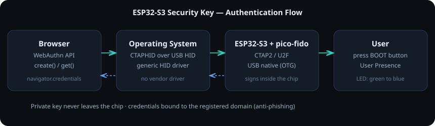
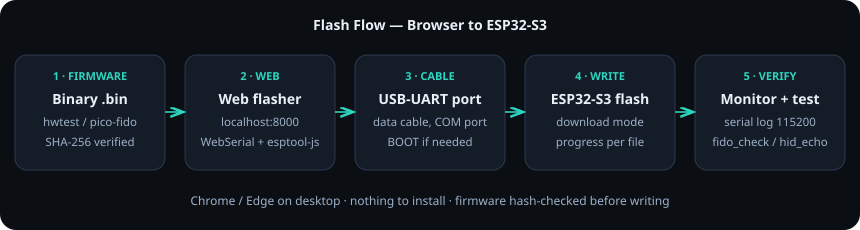

# ESP32-S3 Security Key

 

[Tiêng Việt](README.md) · **English** · [简体中文](README.zh-CN.md)

A USB-C security key for real daily use, built on the ESP32-S3 DevKit. Plug a
C-to-C cable and it works on Android, Linux, Ubuntu and Windows 11. No drivers
needed.

## Scope decisions

- Protocols: FIDO2 (CTAP2/WebAuthn) + U2F (CTAP1), backward compatible.
- Goal: real daily use, with security and stability first.
- Main firmware: [pico-fido](https://github.com/polhenarejos/pico-fido) tag
  v8.2 for ESP32-S3, community-vetted open-source FIDO firmware.
- This repo's own code: hardware test sketch, FIDO HID test tool, flash
  scripts and docs.

Why not write CTAP2 from scratch: one wrong byte in signatures or credential
handling breaks security. For real use, take vetted firmware.

## Repo layout

- [README](README.md) — overview (Vietnamese, this page in English).
- [docs](docs) — idea analysis, architecture, hardware, firmware, usage,
  security, backup/recovery, original PDF references and board photos
  (Vietnamese).
- [docs/research](docs/research) — research notes and related projects.
- [hardware](hardware) — BOM, wiring and key logbook (name + MAC).
- [firmware/hwtest](firmware/hwtest) — Arduino sketch to test the board before
  flashing the main firmware.
- [tools](tools) — Python tools: FIDO HID and HID echo checks, Shamir
  split/combine, BIP-39 mnemonics, encrypted vault, QR export, post-quantum
  key exchange (PQC), ML distinguisher (research), unified key manager
  (`keymgr`), safe file IO (`secureio`) and shared CBOR codec (`cborx`).
- [web](web) — flash the ESP32-S3 from the browser (WebSerial + esptool-js):
  flash hwtest/pico-fido, erase flash, read chip, serial monitor. Open with
  `scripts/web_flasher.ps1` (Windows) or `scripts/web_flasher.sh` (Linux).
- [scripts](scripts) — firmware flash, hwtest build and one-command test.
- [CHANGELOG](CHANGELOG.md) — change history, including the security audit.
- [config](config) — udev rules for Linux.

## Quick start

1. Read the [idea analysis](docs/01-phan-tich-y-tuong.md) (Vietnamese) and
   the [BOM](hardware/BOM.md).
2. Open the web flasher (`scripts/web_flasher.ps1`), flash
   [hwtest](firmware/hwtest/hwtest.ino) to test USB, the BOOT button and LED.

   

3. Follow the [firmware guide](docs/04-firmware.md) (Vietnamese) to build and
   flash pico-fido for ESP32-S3.
4. Install the [udev rules](config/70-u2f.rules) on Linux, then run the
   [test tool](tools/fido_check.py).
5. Read the [usage guide](docs/05-huong-dan-su-dung.md) and
   [security notes](docs/06-bao-mat.md) (Vietnamese).

## Status

In development. Verified on this machine: hwtest sketch compiles cleanly for
ESP32-S3, Python tools pass framing self-tests, Shamir/mnemonic/vault/PQC
tools pass round-trip and CLI tests, firmware builds cleanly in both OTG and
HWCDC modes. pico-fido pinned at tag v8.2 (commit `15b848d8…`, ESP-IDF
v5.5.1), surveyed from the official source, build verification in progress.
Run `scripts/run_tests.ps1` (Windows) or `scripts/run_tests.sh` (Linux) to
re-check everything.

Not done yet (needs real hardware): flashing hwtest, reading CDC logs,
pressing BOOT, checking LED, then flashing pico-fido and running INIT/PING
against the key.

## Research institute dashboard

Open [dashboard/vien.html](dashboard/vien.html) in a browser (double-click,
no network needed): a map of 200 agents in 6 groups × 4 waves, the institute
council, per-agent details, file threads, decisions and heartbeat (Vietnamese
UI). Refresh data with `python tools/vien_dashboard.py`.
