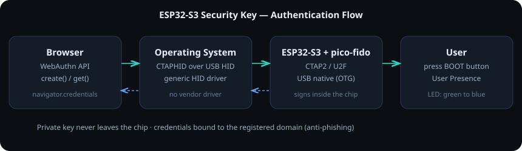
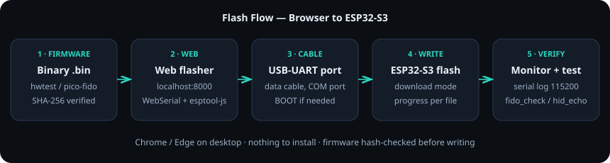

# ESP32-S3 Security Key

 

**Tiếng Việt** · [English](README.en.md) · [简体中文](README.zh-CN.md)

Khóa bảo mật USB-C dùng thật, built trên ESP32-S3 DevKit. Cắm cáp C-to-C là chạy trên Android, Linux, Ubuntu và Windows 11. Không cần cài driver.

## Quyết định phạm vi

- Giao thức: FIDO2 (CTAP2/WebAuthn) + U2F (CTAP1), tương thích ngược.
- Mục tiêu: dùng thật hàng ngày, ưu tiên bảo mật và ổn định.
- Firmware chính: [pico-fido](https://github.com/polhenarejos/pico-fido) tag v8.2 bản ESP32-S3. Đây là firmware FIDO nguồn mở đã được cộng đồng kiểm chứng.
- Code tự viết trong repo: sketch kiểm tra phần cứng, tool kiểm tra FIDO HID, script flash, tài liệu.

Lý do không tự viết CTAP2 từ đầu: giao thức chữ ký và quản lý credential sai một byte là mất an toàn. Mục tiêu dùng thật nên dùng firmware đã kiểm chứng.

## Cấu trúc repo

- [README](README.md) — tổng quan.
- [docs](docs) — phân tích ý tưởng, kiến trúc, phần cứng, firmware, hướng dẫn dùng, bảo mật, sao lưu/khôi phục, tài liệu gốc PDF và ảnh board.
- [docs/research](docs/research) — tài liệu nghiên cứu và dự án liên quan.
- [hardware](hardware) — BOM, sơ đồ đấu nối và sổ theo dõi key (tên + MAC).
- [firmware/hwtest](firmware/hwtest) — sketch Arduino kiểm tra board trước khi flash firmware chính.
- [tools](tools) — tool Python: kiểm tra FIDO HID và HID echo, chia/ghép Shamir, cụm từ BIP-39, két mã hóa, xuất QR, trao đổi khóa hậu lượng tử (PQC), distinguisher ML (nghiên cứu), quản lý key hợp nhất (`keymgr`), module ghi file an toàn (`secureio`) và codec CBOR dùng chung (`cborx`).
- [web](web) — siêu web nạp ESP32-S3 từ trình duyệt (WebSerial + esptool-js): nạp hwtest/pico-fido, xóa flash, đọc chip, monitor log. Mở bằng `scripts/web_flasher.ps1` (Windows) hoặc `scripts/web_flasher.sh` (Linux).
- [scripts](scripts) — script flash firmware, build hwtest và chạy test một lệnh.
- [CHANGELOG](CHANGELOG.md) — lịch sử thay đổi, gồm đợt kiểm toán bảo mật.
- [config](config) — udev rules cho Linux.

## Bắt đầu nhanh

1. Đọc [phân tích ý tưởng](docs/01-phan-tich-y-tuong.md) và [BOM](hardware/BOM.md).
2. Mở siêu web nạp (`scripts/web_flasher.ps1`), nạp [hwtest](firmware/hwtest/hwtest.ino) để kiểm tra USB, nút BOOT và LED.

   
3. Làm theo [hướng dẫn firmware](docs/04-firmware.md) để build và flash pico-fido cho ESP32-S3.
4. Cài [udev rules](config/70-u2f.rules) nếu dùng Linux, rồi chạy [tool kiểm tra](tools/fido_check.py).
5. Đọc [hướng dẫn sử dụng](docs/05-huong-dan-su-dung.md) và [lưu ý bảo mật](docs/06-bao-mat.md).

## Trạng thái

Đang phát triển. Đã kiểm chứng trên máy này: sketch hwtest biên dịch sạch cho ESP32-S3 (arduino-cli 1.6.0, core ESP32 4.0.0, USB CDC On Boot bật), tool Python qua self-test framing INIT/PING (`python tools/fido_check.py --self-test`) và enumeration HID thật bằng hidapi 0.15.0 (không thấy thiết bị vì chưa cắm board). Đã sửa lỗi biến trạng thái nút BOOT báo nhả giả ở vòng lặp đầu.

Chưa thực hiện vì cần phần cứng thật: nạp hwtest, xem log CDC, nhấn nút BOOT, kiểm tra LED, rồi flash pico-fido và chạy INIT/PING với key.

Tool Shamir (`tools/split_secret.py`) đã qua self-test (vector nhân AES, round-trip mọi ngưỡng, từ chối file hỏng) và thử CLI thật: chia 3 share cần 2, ghép đúng bí mật, thiếu share thì từ chối sạch. Tool mnemonic (`tools/mnemonic.py`) qua self-test vector BIP-39 chuẩn và thử liên thông: cùng một bí mật gốc vừa ra 24 từ vừa ra 5 share cần 3, ghép hai đường đều khớp byte.

Đợt nâng cấp mới nhất: `fido_check` kiểm tra cả ba tầng (HID, PING nối gói, CTAP2 GetInfo) với self-test key giả trong RAM; hwtest thêm HID echo, biên dịch sạch cả chế độ OTG (372 KB) và HWCDC (302 KB); thêm `tools/hid_echo.py`, `tools/vault.py` (AES-256-GCM) và lệnh QR cho share/mnemonic, tất cả đã qua self-test và thử CLI thật. Pico-fido chốt tag v8.2 (commit `15b848d8…`, ESP-IDF v5.5.1) từ nguồn chính thức — đã khảo sát, chưa build kiểm chứng. Chạy `scripts/run_tests.ps1` (Windows) hoặc `scripts/run_tests.sh` (Linux) để kiểm tra lại toàn bộ.

Tool PQC (`tools/pqc.py`, ML-KEM-768 qua liboqs) đã qua self-test vòng tròn keygen/encap/decap thật và thử CLI keygen → encap → decap (shared secret hai đầu khớp từng byte); `scripts/run_tests.*` đã tự đặt `OQS_INSTALL_PATH` tới `.tooling/oqs` chứa DLL liboqs. Script nghiên cứu ML (`tools/ml_distinguisher.py`, Speck32/64 rút gọn + MLP numpy) có `--self-test` PASS và kết quả R=5/6/7 trong [nghiên cứu 06](docs/research/06-ml-distinguisher.md) — chỉ để học và minh họa, không dùng vào khóa thật.

## Bảng điều hành Viện Nghiên cứu

Mở [dashboard/vien.html](dashboard/vien.html) bằng trình duyệt (nhấp đúp, không cần mạng): bản đồ 200 agent lồng trong 6 nhóm × 4 đợt, hội đồng Viện, chi tiết từng agent (nhiệm vụ, dòng thời gian, kiểm chéo, file đã đọc/viết), sợi chỉ nối agent tới file công việc, quyết định Viện và nhịp tim. Làm mới dữ liệu bằng `python tools/vien_dashboard.py`.
