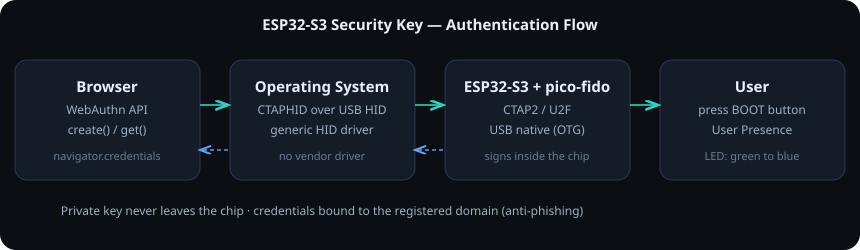
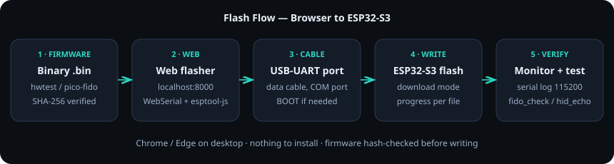

# ESP32-S3 Security Key

 

[Tiêng Việt](README.md) · [English](README.en.md) · **简体中文**

基于 ESP32-S3 DevKit、面向真实日常使用的 USB-C 安全密钥。用 C-to-C 线一插，
即可在 Android、Linux、Ubuntu 和 Windows 11 上使用，无需安装驱动。

## 范围决策

- 协议：FIDO2（CTAP2/WebAuthn）+ U2F（CTAP1），向后兼容。
- 目标：真实日常使用，安全与稳定优先。
- 主固件：[pico-fido](https://github.com/polhenarejos/pico-fido) v8.2 标签的
  ESP32-S3 版本，经过社区验证的开源 FIDO 固件。
- 本仓库自研代码：硬件测试程序、FIDO HID 检测工具、烧录脚本和文档。

为什么不从零写 CTAP2：签名或凭证处理错一个字节就不安全。既然要真用，
就用经过验证的固件。

## 仓库结构

- [README](README.md) — 总览（越南语，本页为中文版）。
- [docs](docs) — 需求分析、架构、硬件、固件、使用、安全、备份恢复、官方
  PDF 与开发板照片（越南语）。
- [docs/research](docs/research) — 研究笔记与相关项目。
- [hardware](hardware) — BOM、接线与密钥台账（名称 + MAC）。
- [firmware/hwtest](firmware/hwtest) — 烧录主固件前检测开发板的 Arduino 程序。
- [tools](tools) — Python 工具：FIDO HID 与 HID 回显检测、Shamir 分割/合并、
  BIP-39 助记词、加密保险库、二维码导出、后量子密钥交换（PQC）、ML
  区分器（研究）、统一密钥管理（`keymgr`）、安全文件读写（`secureio`）、
  CBOR 编解码（`cborx`）。
- [web](web) — 在浏览器里给 ESP32-S3 烧录（WebSerial + esptool-js）：烧录
  hwtest/pico-fido、擦除 flash、读取芯片、串口监视。用
  `scripts/web_flasher.ps1`（Windows）或 `scripts/web_flasher.sh`（Linux）打开。
- [scripts](scripts) — 固件烧录、hwtest 编译、一键测试。
- [CHANGELOG](CHANGELOG.md) — 变更历史，含安全审计。
- [config](config) — Linux udev 规则。

## 快速开始

1. 阅读[需求分析](docs/01-phan-tich-y-tuong.md)（越南语）与
   [BOM](hardware/BOM.md)。
2. 打开网页烧录器（`scripts/web_flasher.ps1`），烧录
   [hwtest](firmware/hwtest/hwtest.ino) 以测试 USB、BOOT 按键和 LED。

   

3. 按[固件指南](docs/04-firmware.md)（越南语）编译并烧录 ESP32-S3 版 pico-fido。
4. Linux 下安装 [udev 规则](config/70-u2f.rules)，再运行[检测工具](tools/fido_check.py)。
5. 阅读[使用指南](docs/05-huong-dan-su-dung.md)与[安全须知](docs/06-bao-mat.md)
   （越南语）。

## 状态

开发中。本机已验证：hwtest 可干净编译、Python 工具自测通过、Shamir/助记词/
保险库/PQC 往返与命令行测试通过、两种模式固件编译正常。pico-fido 锁定 v8.2
标签（提交 `15b848d8…`，ESP-IDF v5.5.1），已从官方源调研，正在验证编译。
运行 `scripts/run_tests.ps1`（Windows）或 `scripts/run_tests.sh`（Linux）
可复查全部。

尚未完成（需要真实硬件）：烧录 hwtest、查看 CDC 日志、按 BOOT 键、检查
LED，然后烧录 pico-fido 并对密钥跑 INIT/PING。

## 研究院运营看板

用浏览器打开 [dashboard/vien.html](dashboard/vien.html)（双击即可，无需联网）：
6 组 × 4 批共 200 个智能体的地图、研究院理事会、每个智能体的详情、文件连线、
决策与心跳（越南语界面）。用 `python tools/vien_dashboard.py` 刷新数据。
