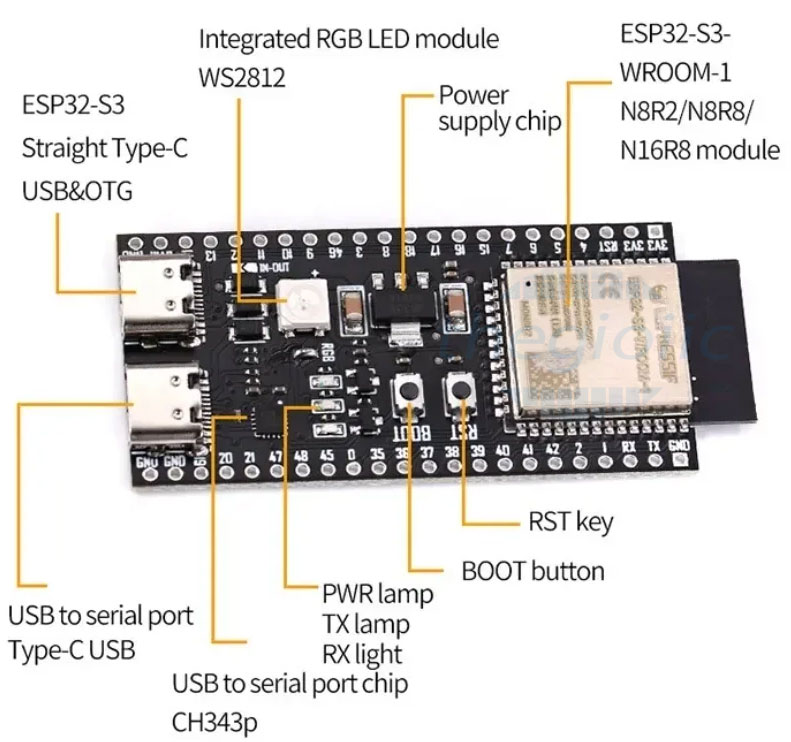

# hardware — Phần cứng và sổ theo dõi

| File | Nội dung |
|------|----------|
| [BOM.md](BOM.md) | Danh mục phần cứng đã chốt: board N16R8 (flash 16 MB + PSRAM 8 MB), cáp, vỏ |
| [wiring.md](wiring.md) | Sơ đồ đấu nối và chân dùng được (GPIO35/36/37 bận cho flash/PSRAM) |
| [keys.md](keys.md) | Sổ theo dõi từng key vật lý: tên + MAC + ngày flash + commit |

Quy tắc sắt: mỗi tài khoản quan trọng đăng ký ít nhất 2 key (U016). Ghi MAC
vào sổ ngay khi nạp hwtest xong (`python tools/keymgr.py provision --name
key-01 --mac XX:XX:XX:XX:XX:XX`). MAC chỉ để định danh, không phải bí mật.
