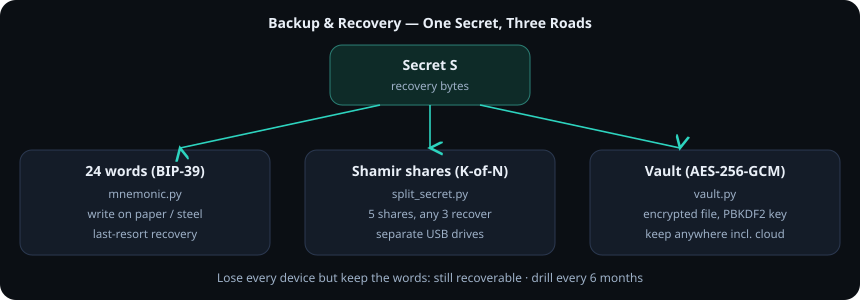

# tools — Bộ tool Python cho PC

Tool chạy trên máy tính để kiểm tra key, quản lý bí mật và vận hành dự án.
Quy ước: mỗi tool có `--self-test` chạy được không cần phần cứng; chạy toàn
bộ bằng `scripts/run_tests.ps1` (Windows) hoặc `scripts/run_tests.sh` (Linux).

## Key và FIDO

| Tool | Việc | Lệnh |
|------|------|------|
| `keymgr.py` | Quản lý key hợp nhất: list, status, attest, provision, reset, pin-retries, backup-check, doctor | `python tools/keymgr.py status` |
| `fido_check.py` | Kiểm tra 3 tầng: HID, PING nối gói, CTAP2 GetInfo | `python tools/fido_check.py` |
| `hid_echo.py` | Kiểm tra echo HID của hwtest (cần bản OTG + cổng native) | `python tools/hid_echo.py` |

## Bí mật và sao lưu

| Tool | Việc | Lệnh |
|------|------|------|
| `split_secret.py` | Chia bí mật Shamir K-trên-N, vẽ QR | `python tools/split_secret.py split --shares 3 --threshold 2 --out DIR` |
| `mnemonic.py` | Cụm từ BIP-39, entropy, seed, QR | `python tools/mnemonic.py new --words 24` |
| `vault.py` | Két AES-256-GCM: mã hóa, mở, đổi mật khẩu | `python tools/vault.py encrypt --in IN --out OUT` |
| `pqc.py` | Trao đổi khóa ML-KEM-768 qua liboqs | `python tools/pqc.py --self-test` |

## Dùng chung

| Tool | Việc |
|------|------|
| `secureio.py` | Ghi file nguyên tử + 0600, chặn tên lách thư mục, đọc giới hạn cỡ |
| `cborx.py` | Codec CBOR cho CTAP2 (giải + mã), fuzz 3000 ca gieo seed |
| `lintsec.py` | Máy quét tĩnh cho `tools/*.py` (17 luật + tự quét) |
| `web_firmware.py` | Sinh và kiểm tra manifest firmware cho web nạp (`--check`) |
| `gen_sign_key.py` | Sinh khóa ký Secure Boot ngoại tuyến (chạy 1 lần) |

## Nghiên cứu và vận hành Viện

| Tool | Việc |
|------|------|
| `ml_distinguisher.py` | Nghiên cứu distinguisher ML (học thuật, không dùng vào khóa thật) |
| `kanzo.py` | Client API bảng Kanzo dùng chung |
| `vien_dashboard.py`, `vien_nhip_tim.py`, `vien_cong.py` | Dashboard và nhịp tim Viện Nghiên cứu (cần dữ liệu nội bộ; self-test tự bỏ qua khi thiếu) |

## Thư viện

Cài vào `.tooling/pylibs`, không cài system-wide (xem từng `requirements*.txt`
đã ghim phiên bản). `ml_distinguisher` cần numpy, `pqc` cần liboqs native
(xem docstring trong file).
